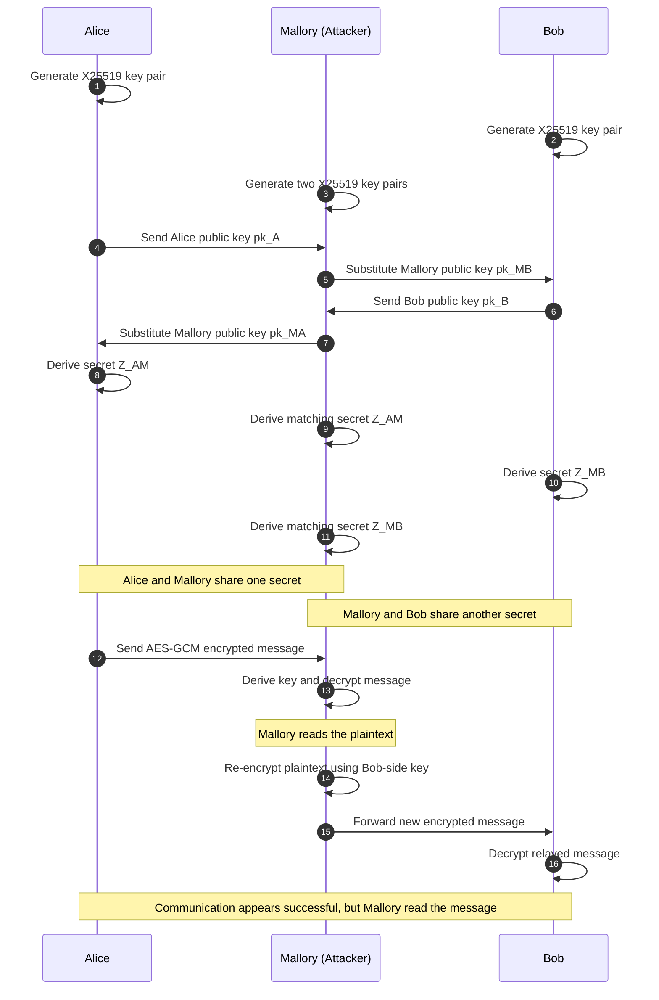
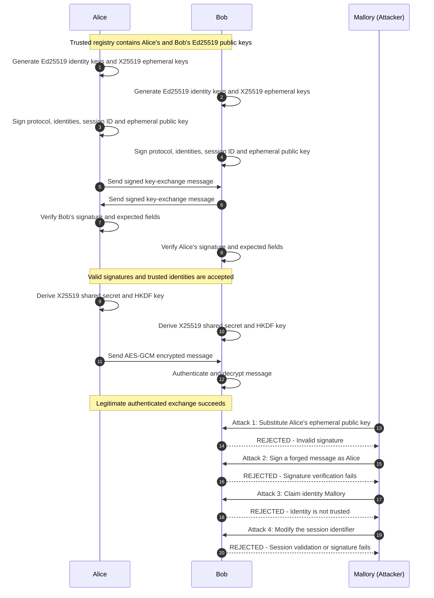
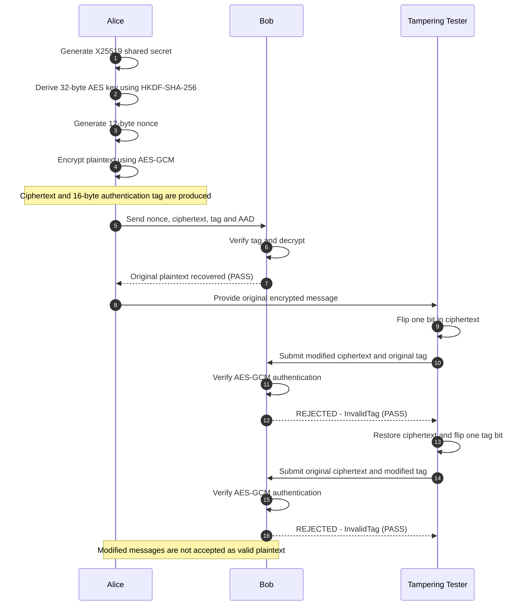

# Protocol Diagrams: Diffie–Hellman Key Exchange, MITM Attack and Authenticated Defence

This document contains four Mermaid sequence diagrams representing the cryptographic scenarios implemented in `crypto_utils.py` and `scenarios.py`. The diagrams use symbolic notation and do not expose actual private keys or shared-secret values.

The project uses X25519 for key agreement, HKDF-SHA-256 for key derivation, AES-GCM for authenticated encryption, and Ed25519 digital signatures for authentication.

---

## 1. Scenario A: Normal Unauthenticated Diffie–Hellman Key Exchange (X25519 + HKDF + AES-GCM)

### Purpose

Demonstrates how Alice and Bob independently generate ephemeral X25519 key pairs, exchange public keys, derive the same shared secret, and use HKDF-SHA-256 to derive a 32-byte AES key. Alice encrypts a message with AES-GCM, and Bob verifies and decrypts it.

### Mermaid Code

```mermaid
sequenceDiagram
    autonumber
    participant Alice as Alice (Initiator)
    participant Bob as Bob (Responder)

    Note over Alice,Bob: Public Session Context: protocol, session_id and salt

    Alice->>Alice: Generate ephemeral X25519 key pair (sk_A, pk_A)
    Bob->>Bob: Generate ephemeral X25519 key pair (sk_B, pk_B)

    Alice->>Bob: Send ephemeral public key pk_A (32 bytes)
    Bob->>Alice: Send ephemeral public key pk_B (32 bytes)

    Alice->>Alice: Z_A = X25519(sk_A, pk_B)
    Bob->>Bob: Z_B = X25519(sk_B, pk_A)

    Note over Alice,Bob: Z_A = Z_B; shared secret is never transmitted

    Alice->>Alice: Derive K_app using HKDF-SHA-256
    Bob->>Bob: Derive K_app using HKDF-SHA-256

    Note over Alice,Bob: Both derive matching 32-byte AES keys

    Alice->>Alice: Generate fresh 12-byte nonce N
    Alice->>Alice: Encrypt plaintext using AES-GCM
    Alice->>Bob: Send nonce, ciphertext, tag and AAD

    Bob->>Bob: Verify authentication tag and decrypt
    Bob-->>Alice: Plaintext recovered successfully

    Note over Alice,Bob: Confidential message exchange succeeds
```

### Expected Outcome

- Alice and Bob derive matching shared secrets and AES keys.
- Bob recovers the original plaintext.
- The exchange succeeds when no attacker interferes.

**Security observation:** Diffie–Hellman provides key agreement but does not, by itself, authenticate the communicating parties.

---

## 2. Scenario B: Unauthenticated Man-in-the-Middle (MITM) Attack

### Purpose

Demonstrates how Mallory intercepts and substitutes public keys during an unauthenticated exchange. Mallory establishes separate shared secrets with Alice and Bob, decrypts Alice's message, and re-encrypts it for Bob.

### Mermaid Code



### Expected Outcome

- Alice and Mallory derive matching keys for their connection.
- Mallory and Bob derive matching keys for their connection.
- The two connections use different secrets and encryption keys.
- Mallory successfully reads and relays the plaintext.

**Security observation:** The unauthenticated exchange is vulnerable to a MITM attack because neither party verifies the identity associated with the received public key.

---

## 3. Scenario C: Authenticated Key Exchange and MITM Defence (Ed25519 + Trusted Registry)

### Purpose

Demonstrates how Ed25519 digital signatures authenticate key-exchange messages. The signature covers the protocol identifier, sender, recipient, session identifier and ephemeral X25519 public key. A trusted public-key registry allows the receiver to verify the sender's identity.

The scenario also demonstrates rejection of four attack attempts: public-key substitution, signature forgery, an untrusted identity and session-identifier modification.

### Mermaid Code



### Expected Outcome

- Legitimate authenticated key exchange and encrypted communication succeed.
- A substituted public key is rejected because it is not covered by the original valid signature.
- A forged signature is rejected.
- An identity absent from the trusted registry is rejected.
- A modified session identifier is rejected by session validation or signature verification.

**Security observation:** Authentication binds the ephemeral public key to the claimed identity and session context, preventing the public-key substitution demonstrated in Scenario B.

*Implementation note:* The trusted registry is simulated using an in-memory dictionary with freshly generated identity keys. It represents the trust mechanism for this educational demonstration rather than a persistent production identity infrastructure.

---

## 4. Scenario D: AES-GCM Authenticated Encryption and Tampering Detection

### Purpose

Demonstrates AES-GCM's ability to detect changes to encrypted data. The program first decrypts an unchanged message, then flips one bit in the ciphertext and one bit in the authentication tag in separate experiments.

### Mermaid Code



### Expected Outcome

- Unmodified ciphertext decrypts to the original plaintext.
- Modified ciphertext fails authentication.
- A modified authentication tag fails authentication.
- The scenario also checks that two independently encrypted messages use distinct nonces.

**Security observation:** AES-GCM provides confidentiality and integrity/authenticity for encrypted messages and associated authenticated data (AAD). Tampering with the ciphertext or authentication tag causes decryption to fail.

---

## Summary of the Four Scenarios

| Scenario | Name | Main purpose | Expected result |
|---|---|---|---|
| A | Normal unauthenticated exchange | Demonstrate X25519, HKDF and AES-GCM | Key agreement and decryption succeed |
| B | Unauthenticated MITM attack | Demonstrate public-key substitution and interception | Mallory reads and relays the message |
| C | Authenticated key exchange | Demonstrate Ed25519 identity authentication | Legitimate exchange succeeds; attack attempts are rejected |
| D | AES-GCM tampering detection | Demonstrate encrypted-message integrity | Original decrypts; tampered messages are rejected |

**Conclusion:** These four scenarios illustrate why secure communication requires more than key agreement alone. X25519 establishes a shared secret, HKDF derives application keys, AES-GCM protects message confidentiality and integrity, and Ed25519 signatures with trusted identity keys help defend against man-in-the-middle attacks.
