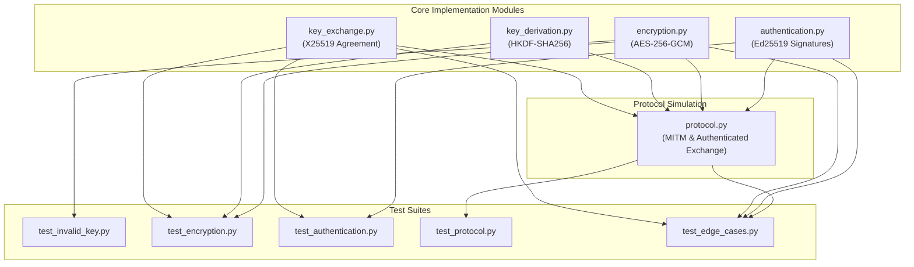

# Project Walkthrough: Diffie–Hellman Key Exchange and Man-in-the-Middle Attack

This walkthrough is a straightforward guide for students and developers who want to understand this project without having to read every single line of Python code.

---

## 1. Project Overview

This project demonstrates how two parties (Alice and Bob) can establish a secure, encrypted conversation and how an active attacker (Mallory) can manipulate or be blocked by the protocol:

* **Diffie–Hellman Key Exchange (X25519):** Allows Alice and Bob to calculate a matching **shared secret** over an untrusted channel without transmitting the secret itself.
* **The MITM Attack:** Because raw Diffie–Hellman public keys do not prove identity, an active attacker (Mallory) can intercept public keys, substitute her own, and establish separate encrypted connections with both Alice and Bob. Mallory can then read and relay messages in cleartext.
* **The Solution (Ed25519 Digital Signatures):** Alice and Bob sign their ephemeral public keys using pre-trusted identity keys, binding the sender, recipient, and protocol version. When Mallory substitutes her key, signature verification fails and the connection aborts before any secret is derived.

---

## 2. Key Cryptographic Terms in Plain English

* **X25519:** A fast, modern Elliptic Curve Diffie-Hellman algorithm using Curve25519 for secure key agreement.
* **Shared Secret:** A 32-byte secret value calculated independently by both sides. An eavesdropper watching the network cannot calculate this value.
* **HKDF (HMAC-based Key Derivation Function):** A mathematical function that converts raw, non-uniform shared secrets into cryptographically strong symmetric keys.
* **AES-256-GCM:** An authenticated encryption algorithm that provides confidentiality (keeps data secret) and integrity (detects any tampering using a 16-byte authentication tag).
* **Nonce (Number Used Once):** A fresh 12-byte random number generated for every encryption so two identical messages never produce the same ciphertext.
* **Ed25519:** A modern digital signature system based on Edwards-curve Curve25519.
* **Digital Signature:** A cryptographic proof that a specific piece of data was approved by the owner of a private key and has not been altered.

---

## 3. Detailed Walkthrough of Every Python File

### Implementation Files

#### `key_exchange.py`
* **Purpose:** Handles X25519 key generation, Diffie-Hellman shared secret derivation, and constant-time secret comparison.
* **Imports:**
  * `hmac`: Used for `hmac.compare_digest` to compare secrets safely.
  * `X25519PrivateKey, X25519PublicKey` from `cryptography`: Established implementations of Curve25519 key agreement.
* **Functions:**
  * **`generate_key_pair()`**: Generates a fresh X25519 private key and its corresponding public key using the operating system's random generator.
  * **`derive_shared_secret(private_key, peer_public_key)`**: Multiplies the local private key by the peer's public key to derive the raw 32-byte Diffie-Hellman shared secret.
  * **`verify_shared_secret(secret_a, secret_b)`**: Compares two shared secrets using constant-time comparison to prevent timing side-channel attacks.
* **Important Security Detail:** Raw X25519 does not authenticate who owns the public key. An attacker can swap public keys unless an authentication layer is added.

---

#### `key_derivation.py`
* **Purpose:** Expands the raw Diffie-Hellman shared secret into a uniform 32-byte symmetric key for AES-256 encryption.
* **Imports:**
  * `hashes`: Provides the SHA-256 hash algorithm.
  * `HKDF`: Implements the standard HMAC-based Key Derivation Function (RFC 5869).
* **Functions:**
  * **`derive_key(shared_secret, salt=None, info=b"dh-mitm-project-v1")`**: Applies the extract-and-expand steps of HKDF-SHA256 to produce exactly 32 pseudorandom bytes.
* **Important Security Detail:** Raw curve points from Diffie-Hellman are not uniformly distributed random numbers. HKDF smooths out entropy and uses the `info` context string to prevent the derived key from being used in other protocols.

---

#### `encryption.py`
* **Purpose:** Provides authenticated encryption and decryption for messages using AES-256-GCM.
* **Imports:**
  * `os`: Used for `os.urandom(12)` to sample fresh, cryptographically secure nonces.
  * `AESGCM`: Implements AES in Galois/Counter Mode (AEAD).
* **Functions:**
  * **`encrypt_message(key, plaintext)`**: Generates a random 12-byte nonce, encrypts the plaintext with AES-256, and returns `(nonce, ciphertext)` with the 16-byte authentication tag appended.
  * **`decrypt_message(key, nonce, ciphertext)`**: Verifies the authentication tag and decrypts the ciphertext back into plaintext.
* **Important Security Detail:** Requires keys to be exactly 32 bytes (raising `ValueError` otherwise). If any byte of the ciphertext or tag is modified, `AESGCM.decrypt` raises `cryptography.exceptions.InvalidTag`.

---

#### `authentication.py`
* **Purpose:** Implements Ed25519 digital signatures that bind an X25519 public key to a sender identity, recipient identity, and protocol identifier.
* **Imports:**
  * `InvalidSignature`: Exception raised when signature verification fails.
  * `serialization`: Serializes public keys into raw 32-byte format.
  * `Ed25519PrivateKey, Ed25519PublicKey`: Long-term identity signing key pairs.
  * `X25519PublicKey`: Type check for key-exchange public keys.
* **Constants:**
  * `DEFAULT_PROTOCOL_ID = b"dh-mitm-v2"`: A fixed protocol string ensuring signatures cannot be reused in older protocol versions.
* **Functions:**
  * **`generate_signing_key_pair()`**: Generates a long-term Ed25519 private signing key and public verification key.
  * **`build_canonical_message(exchange_public_key, sender_id, recipient_id, protocol_id)`**: Formats an unambiguous, length-prefixed byte string containing the protocol ID, sender ID, recipient ID, and raw public key bytes.
  * **`sign_public_key(signing_private_key, exchange_public_key, sender_id, recipient_id, protocol_id)`**: Constructs the canonical message and signs it with the Ed25519 private key, returning a 64-byte signature.
  * **`verify_public_key_signature(trusted_signing_public_key, exchange_public_key, signature, sender_id, recipient_id, protocol_id)`**: Constructs the canonical message and verifies the signature using the peer's pre-trusted Ed25519 public key. Returns `True` if valid, or `False` if `InvalidSignature` is raised.
* **Important Security Detail:** Length-prefix framing (`len(data) + data`) prevents delimiter injection attacks. Explicitly binding the sender and recipient prevents unknown key-share and misbinding attacks.

---

#### `protocol.py`
* **Purpose:** Simulates both the vulnerable unauthenticated key exchange and the protected authenticated key exchange.
* **Imports:**
  * `InvalidSignature, InvalidTag`: Crypto exceptions.
  * Functions from `key_exchange`, `key_derivation`, `encryption`, and `authentication`.
* **Functions:**
  * **`simulate_unauthenticated_mitm(message)`**: Demonstrates the classic MITM attack where Mallory intercepts Alice's and Bob's public keys, replaces them with her own, establishes separate secrets, and intercepts/relays encrypted messages.
  * **`simulate_authenticated_exchange(message)`**: Demonstrates legitimate authenticated communication where Alice and Bob verify each other's Ed25519 signatures before deriving session keys.
  * **`simulate_authenticated_mitm_attempt()`**: Demonstrates Mallory trying to inject her public key into an authenticated exchange. Because she lacks Alice's private signing key, verification fails and the exchange aborts immediately.
* **Important Security Detail:** All simulations run locally in-memory. No network sockets or real network traffic are used.

---

### Test Files

#### `test_invalid_key.py`
* **Component Tested:** Key-length validation in [`encryption.py`](file:///c:/Users/HRao2/dh_mitm_project/encryption.py).
* **Test Functions:**
  * **`test_invalid_key_length()`**: Passes a short key (`b"short-key"`) to `encrypt_message` and confirms it raises `ValueError`.
* **Passing Result:** Confirms that non-32-byte encryption keys are rejected immediately.

#### `test_encryption.py`
* **Component Tested:** AES-256-GCM tamper detection in [`encryption.py`](file:///c:/Users/HRao2/dh_mitm_project/encryption.py).
* **Test Functions:**
  * **`test_ciphertext_tampering()`**: Encrypts a test message, flips a bit in the ciphertext, and confirms `decrypt_message` raises `InvalidTag`.
* **Passing Result:** Confirms that any altered ciphertext is detected and rejected.

#### `test_authentication.py`
* **Component Tested:** Core Ed25519 signing and verification behavior in [`authentication.py`](file:///c:/Users/HRao2/dh_mitm_project/authentication.py).
* **Test Functions:**
  * **`test_authentication()`**: Tests three scenarios:
    1. A genuine signature with the correct sender and recipient is accepted (`True`).
    2. Mallory signing her own key is rejected when checked against Alice's trusted public key (`False`).
    3. Alice's signature paired with Mallory's substituted public key is rejected (`False`).
* **Passing Result:** Confirms that digital signatures identify genuine keys and block forgeries.

#### `test_protocol.py`
* **Component Tested:** Full protocol simulation workflows in [`protocol.py`](file:///c:/Users/HRao2/dh_mitm_project/protocol.py).
* **Test Functions:**
  * **`test_unauthenticated_mitm()`**: Asserts that `simulate_unauthenticated_mitm()` succeeds in eavesdropping and relaying while Alice and Bob derive mismatched secrets.
  * **`test_authenticated_exchange()`**: Asserts that `simulate_authenticated_exchange()` succeeds with matching secrets and verified signatures.
  * **`test_authenticated_mitm_blocked()`**: Asserts that `simulate_authenticated_mitm_attempt()` blocks key derivation and message transfer.
* **Passing Result:** Confirms that unauthenticated Diffie-Hellman is vulnerable, while authenticated Diffie-Hellman stops the attack.

#### `test_edge_cases.py`
* **Component Tested:** Comprehensive boundary conditions and security checks using Python's built-in `unittest` framework.
* **Test Functions (11 Unit Tests):**
  * **`test_aes_gcm_rejects_modified_authentication_tag`**: Confirms modifying the authentication tag raises `InvalidTag`.
  * **`test_aes_gcm_rejects_invalid_nonce_length`**: Confirms nonces < 8 bytes raise `ValueError`, while nonces of length 16 raise `InvalidTag`.
  * **`test_encryption_rejects_non_32_byte_keys`**: Tests 0, 16, 24, 31, 33, and 64-byte keys, ensuring `ValueError` is raised.
  * **`test_ed25519_verification_rejects_untrusted_signing_key`**: Checks signature rejection when made by an untrusted key.
  * **`test_ed25519_verification_rejects_substituted_exchange_public_key`**: Checks rejection when an X25519 key is swapped.
  * **`test_ed25519_verification_rejects_wrong_sender`**: Checks signature rejection if the verified sender ID does not match the signed sender ID.
  * **`test_ed25519_verification_rejects_wrong_recipient`**: Checks signature rejection if the recipient ID is altered.
  * **`test_ed25519_verification_rejects_wrong_protocol_context`**: Checks signature rejection if the protocol version string differs.
  * **`test_unauthenticated_mitm_simulation_succeeds`**: Asserts the unauthenticated MITM simulation runs and produces expected attack flags.
  * **`test_authenticated_exchange_simulation_succeeds`**: Asserts the authenticated exchange simulation succeeds end-to-end.
  * **`test_authenticated_mitm_attempt_is_blocked`**: Asserts the authenticated MITM attempt detects substitution and blocks exchange.
* **Passing Result:** Confirms all security invariants, error handling, and boundary checks pass completely.

---

## 4. How the Files Work Together

The system operates in a clear layered progression:

```
[ key_exchange.py ]       Generate X25519 keys & compute raw shared secrets
        │
[ key_derivation.py ]     Turn raw shared secrets into 32-byte AES keys using HKDF
        │
[ encryption.py ]         Encrypt and decrypt application messages with AES-256-GCM
        │
[ authentication.py ]     Bind ephemeral keys to identities with Ed25519 signatures
        │
[ protocol.py ]           Simulate both unauthenticated and authenticated exchanges
        │
[ Test Suites ]           Verify edge cases, security guarantees, and full workflows
```

1. **Key Agreement:** [`key_exchange.py`](file:///c:/Users/HRao2/dh_mitm_project/key_exchange.py) creates public/private key pairs for each participant.
2. **Key Derivation:** [`key_derivation.py`](file:///c:/Users/HRao2/dh_mitm_project/key_derivation.py) extracts and expands the shared secret into an AES encryption key.
3. **Encryption:** [`encryption.py`](file:///c:/Users/HRao2/dh_mitm_project/encryption.py) encrypts cleartext payloads into authenticated ciphertexts.
4. **Authentication:** [`authentication.py`](file:///c:/Users/HRao2/dh_mitm_project/authentication.py) provides the digital identity signatures that prevent key tampering.
5. **Orchestration:** [`protocol.py`](file:///c:/Users/HRao2/dh_mitm_project/protocol.py) combines these modules to simulate both attack and defense scenarios.
6. **Validation:** The test files run automated assertions against each layer.

---

## 5. File Interaction Diagram



---

## 6. How to Run the Project

Run each test suite using the project virtual environment in PowerShell:

```powershell
# 1. Run the comprehensive unit and edge-case test suite (11 tests)
.\.venv\Scripts\python.exe -m unittest test_edge_cases.py -v

# 2. Run the protocol simulation tests (3 scenarios)
.\.venv\Scripts\python.exe test_protocol.py

# 3. Run the authentication unit checks (3 checks)
.\.venv\Scripts\python.exe test_authentication.py

# 4. Run the ciphertext tampering test (1 test)
.\.venv\Scripts\python.exe test_encryption.py

# 5. Run the key-length validation test (1 test)
.\.venv\Scripts\python.exe test_invalid_key.py
```

*Note: Running implementation modules directly (such as `key_exchange.py`) defines functions and exits silently with code 0 without output, which is normal.*

---

## 7. Expected Outcomes vs. Observed Results

### Expected Theoretical Outcomes
* **Unauthenticated MITM Attack:** Alice and Bob must derive separate shared secrets with Mallory (`alice_bob_secret_match == False`). Mallory must be able to decrypt Alice's message in cleartext and relay it to Bob.
* **Authenticated Key Exchange:** Alice and Bob must verify each other's Ed25519 signatures, derive matching keys, and successfully decrypt messages.
* **Rejected Substituted Public Key:** If Mallory tries to insert her public key or change sender/recipient identities, verification must fail and the protocol must abort before establishing keys.
* **Ciphertext Tampering Detection:** Any modified ciphertext or authentication tag must cause AES-GCM to reject decryption with `InvalidTag`.

### Observed Results from Test Execution
All 5 test suites were executed in the project virtual environment (`.\.venv\Scripts\python.exe`). Every test passed cleanly:
* `test_edge_cases.py`: Ran 11 tests in 0.013s — **OK (All Passed)**
* `test_protocol.py`: **All protocol tests passed (All Passed)**
* `test_authentication.py`: Accepted genuine signature, rejected Mallory's signature, rejected substituted public key — **PASS**
* `test_encryption.py`: Tampering detection — **PASS**
* `test_invalid_key.py`: Invalid key rejection — **PASS**

---

## 8. Limitations and Security Notes

1. **Assumes Pre-Shared Public Keys:** The authenticated simulation assumes Alice and Bob already trust each other's Ed25519 public keys (out-of-band trust anchor). In real Internet systems, this trust is usually provided by Public Key Infrastructure (PKI) certificates or pre-shared contact lists (like Signal's safety numbers).
2. **In-Memory Demonstration:** All simulations run locally in-memory for educational purposes and do not listen on external network sockets or sniff network interfaces.
3. **Never Log Secrets:** Private keys, raw shared secrets, derived keys, and plaintext passwords are never printed to the console or written to disk.

